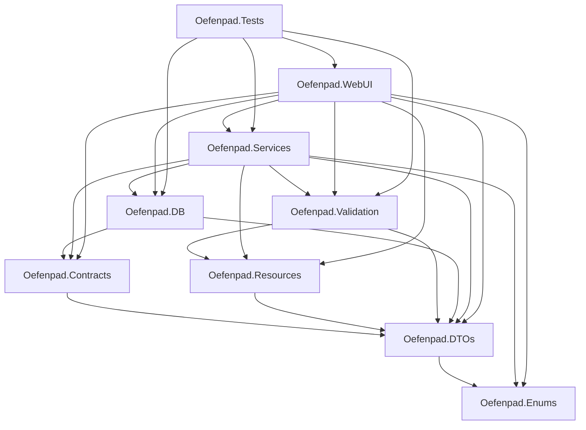
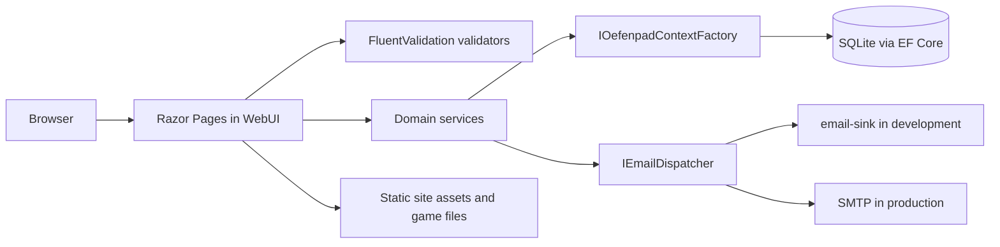
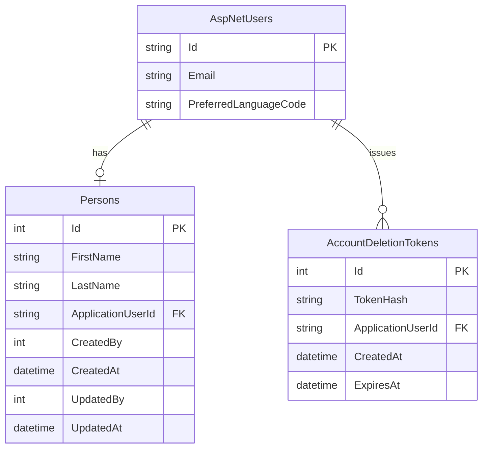

# Accounts handover — 2026-11-09

This is the session record for the work that added sign-up and account management
to Oefenpad. It explains what was built, why each choice was made, where every
file lives, and what a future agent should check before changing it.

The living how-it-works reference is [`accounts.md`](accounts.md). Read that for
the flows and conventions; read this for the map, the rejected alternatives and
the evidence that the thing actually ran.

## In one paragraph

`server/` is now a nine-project .NET 10 solution. It adds one-person sign-up and
account management to the existing static site: register, confirm the email,
sign in, change name, change email, change password, choose the email language,
reset a forgotten password, and delete the account through a two-step emailed
link. The account pages are Razor Pages, use ASP.NET Core Identity with SQLite,
validate with FluentValidation, and carry Dutch and English in the same markup.
The same host also serves the static site from the repository root, but only
`/assets` and `/src` are exposed.

Scope was deliberately single-person. There are no organisations, groups,
invitations, tenants or roles beyond Identity's default role table.

## Status

| Item | State |
|---|---|
| Build (`dotnet build server/Oefenpad.sln`) | 0 warnings, 0 errors |
| Tests (`dotnet test server/Oefenpad.Tests`) | 8 passed, 0 failed |
| Live HTTP smoke test on 8098 | Run earlier this session; every account flow passed |
| Screenshots (light, dark, NL, EN, signed-in, 420 px) | Reviewed earlier this session |
| Committed / pushed | **No.** The working tree is dirty and `main` is 8 commits unpushed |
| Database | Reset to schema-only after the smoke test; server stopped |

## Documentation changed this session

| File | Change |
|---|---|
| `Docs/accounts.md` | Added a project-level "Where the code lives" map and a cross-link to this handover. It remains the living how-it-works reference. |
| `Docs/accounts-handover.md` | This session record: decisions, architecture diagrams, file-by-file map, recipes, evidence and risks. |
| `CLAUDE.md` | Added this handover to "Start here" and pointed the accounts paragraph at it. |
| `Docs/decisions.md` | Added the single-person account scope to "Settled", with pointers to `accounts.md` and this handover. |

## Decisions made this session

These are the choices a future agent is likely to question. Each one was made
against the TotumTeams sample, the design system, or the agreed single-person
scope.

| Decision | Why |
|---|---|
| **Razor Pages, not Blazor or MudBlazor** | The site's design system is hand-written CSS in `assets/site/oefenpad.css`. A component framework would fight `Docs/designguide.md`, and the pages need no interactive circuit. Razor Pages keeps the server-rendered shape and the bilingual CSS switch trivial. |
| **`Bilingual` records instead of `.resx` / `IStringLocalizer`** | Every page ships both languages. A message should carry both texts to the page, not depend on a request culture. `Bilingual` also survives being returned from a service. |
| **No organisations, groups, members or roles** | Agreed scope: one person, one account. Adding tenancy tables now would be unused structure. |
| **Validation messages live in FluentValidation `CustomState`** | `AccountPageModel.ValideerAsync` reads the `Bilingual` from `CustomState`, adds it to `Fouten`, and marks the field. `.WithMessage` still carries the Dutch text so any other consumer of `ErrorMessage` sees something sensible. |
| **Business failures return `Result<T>`; unexpected failures throw** | TotumTeams convention. A duplicate email, a wrong password or an expired token is an expected answer, not an exception. Infrastructure failures are logged and turned into a generic `Result` only where the user needs an answer. |
| **Bilingual emails are rendered in code (`AccountEmails`)** | Five messages plus a password-changed notice. Embedded HTML templates would add a loader and a file dependency for no gain at this size. |
| **Account deletion is two-step: password, then a one-hour emailed link; only a SHA-256 hash is stored** | GDPR Article 17 needs a real deletion path. The password proves the request is the holder's; the emailed link proves the mailbox is still theirs. The raw token exists only in the email. The confirmation page is anonymous because the link is the credential. |
| **Changing the email signs the user out and marks the address unconfirmed** | The existing cookie names the old address and the new address has not been proved. Signing out avoids a session that claims an address it no longer owns. |
| **SQLite + `IDbContextFactory` + `ExecuteWithRetryAsync`** | Matches TotumTeams. SQLite is enough now; the factory and retry wrapper keep a PostgreSQL move from changing service code. |
| **Rate limits apply to POST only** | A Razor Page `[EnableRateLimiting]` attribute covers the GET that renders the form too. Without the method check, a person correcting a form a few times exhausts the budget and sees a false 429. This happened twice during testing. |
| **In Development the registration page shows the confirmation link** | There is no real mailbox in development. The link is rendered only under `environment.IsDevelopment()`; it is never shown outside Development. |
| **The server serves only `/assets` and the WebUI `wwwroot/` from the site root** | Serving the repository root would expose `.git` and `server/`. The home and legal pages are mapped as explicit routes; the React games are served from `wwwroot/spelen/`. (This originally read `/assets` and `/src`; the old `src/` game folders were removed when the games moved to React.) |

## Architecture map

### Project graph

Arrows point at the project being referenced (A → B means A references B).



The rule behind the layering: dependencies only point inward. `Contracts` knows
interfaces but no implementation. `DB` knows persistence. `Services` knows
business rules. `WebUI` knows HTTP and HTML. `Tests` is the only project allowed
to reference everything.

### Runtime shape



One process, one SQLite file, one email adapter selected at start-up by
`Email:SmtpHost`. There is no queue, no background worker and no second service.

### Request routing

| URL | Page / mapping | Page model | Service |
|---|---|---|---|
| `/`, `/index.html` | `StaticPage("index.html")` | — | — |
| `/privacy.html`, `/voorwaarden.html` | `StaticPage(...)` | — | — |
| `/Account/Registreren` | `Pages/Account/Registreren.cshtml` | `RegistrerenModel` | `IRegistrationService.RegisterAsync` |
| `/Account/Bevestig` | `Pages/Account/Bevestig.cshtml` | `BevestigModel` | `IRegistrationService.ConfirmEmailAsync` |
| `/Account/BevestigOpnieuw` | `Pages/Account/BevestigOpnieuw.cshtml` | `BevestigOpnieuwModel` | `IRegistrationService.ResendConfirmationAsync` |
| `/Account/Inloggen` | `Pages/Account/Inloggen.cshtml` | `InloggenModel` | `SignInManager.PasswordSignInAsync` |
| `/Account/Uitloggen` | `Pages/Account/Uitloggen.cshtml` | `UitloggenModel` | `SignInManager.SignOutAsync` |
| `/Account/Account` | `Pages/Account/Account.cshtml` | `AccountModel` | `IAccountService.GetProfileAsync` / `ChangeLanguageAsync` |
| `/Account/Naam` | `Pages/Account/Naam.cshtml` | `NaamModel` | `IAccountService.ChangeNameAsync` |
| `/Account/E-mail` | `Pages/Account/E-mail.cshtml` | `EmailModel` | `IAccountService.ChangeEmailAsync` |
| `/Account/Wachtwoord` | `Pages/Account/Wachtwoord.cshtml` | `WachtwoordModel` | `IAccountService.ChangePasswordAsync` |
| `/Account/WachtwoordVergeten` | `Pages/Account/WachtwoordVergeten.cshtml` | `WachtwoordVergetenModel` | `IAccountService.SendPasswordResetAsync` |
| `/Account/WachtwoordHerstellen` | `Pages/Account/WachtwoordHerstellen.cshtml` | `WachtwoordHerstellenModel` | `IAccountService.ResetPasswordAsync` |
| `/Account/Verwijderen` | `Pages/Account/Verwijderen.cshtml` | `VerwijderenModel` | `IAccountDeletionService.RequestDeletionAsync` |
| `/Account/Verwijderen/Bevestig` | `Pages/Account/Verwijderen/Bevestig.cshtml` | `BevestigModel` | `IAccountDeletionService.ConfirmDeletionAsync` |
| `/Account/Verwijderd` | `Pages/Account/Verwijderd.cshtml` | `VerwijderdModel` | — (success page) |
| `/Account/ToegangGeweigerd` | `Pages/Account/ToegangGeweigerd.cshtml` | `ToegangGeweigerdModel` | — |

`Pages/Account/AccountPageModel.cs` is the shared base for almost every page. It
holds `Fouten`, `Waarschuwingen`, `Gelukt` and `FouteVelden`, plus
`NeemResultaatOver`, `ValideerAsync` and `VeldClass`.

### Sign-up flow

1. `POST /Account/Registreren` binds `RegisterRequest` and runs
   `RegisterRequestValidator`.
2. `RegistrationService.RegisterAsync` creates the `ApplicationUser`, then the
   `Person`. If the `Person` save fails, the user is deleted again so a retry
   does not collide with a half-created account.
3. Identity generates an email-confirmation token. `AccountEmails.Bevestig`
   renders the bilingual message and `IEmailDispatcher` writes or sends it.
4. `RequireConfirmedEmail = true` blocks sign-in until
   `/Account/Bevestig` calls `ConfirmEmailAsync`.
5. In Development the page also exposes `ConfirmationUrl` from
   `RegistrationResult` so the flow can be finished without a mailbox.

### Data model



Identity's own role, claim, login and token tables are present but unused beyond
Identity's defaults.

Important persistence details:

- `Persons.ApplicationUserId` is **nullable and uniquely indexed**. A profile can
  exist briefly without a login, and one login cannot own two profiles.
- The `Person → ApplicationUser` foreign key is `SetNull`. That is why account
  deletion removes the `Person` **before** deleting the user; the other order
  leaves an orphan holding the name.
- Every `DateTime` passes through `UtcDateTimeConverter` on the way in and out.
  SQLite returns `Unspecified`, so the converter stamps `Utc` both ways.
- Audit fields (`CreatedBy`, `CreatedAt`, `UpdatedBy`, `UpdatedAt`) are applied
  in `OefenpadDbContext.SaveChangesAsync` to anything deriving from
  `AuditableEntry`. The author is the `PersonId` claim, which can be null during
  registration.
- Reads in services are projections (`Select(...)`); there is no `Include`.

### Authentication and tokens

- Cookie name `oefenpad.auth`, `HttpOnly`, `SameSite=Lax`,
  `SecurePolicy = SameAsRequest` (production must be HTTPS), 14 days with sliding
  expiration.
- Security stamp checked every minute, so a password change ends other sessions
  quickly.
- Identity's password reset and email-confirmation tokens last 24 hours
  (`DataProtectionTokenProviderOptions`).
- Account-deletion tokens last **one hour** and are stored only as a SHA-256 hex
  hash. A new request deletes the previous rows, so only the latest email works.
- `OefenpadUserClaimsPrincipalFactory` adds `oefenpad:person_id` and
  `oefenpad:taal` to the cookie. `CurrentUserService` reads them; no database
  lookup is needed for the audit stamp or the email language.

### Email path

```
page / service
    → AccountEmails.<message>(name, link, language)   // EmailContent
    → EmailMessage(to, Bilingual subject, HTML body)
    → IEmailDispatcher
        → FileEmailDispatcher   when Email:SmtpHost is empty
        → SmtpEmailDispatcher   when Email:SmtpHost is set
```

`IdentityEmailSender` adapts Identity's `IEmailSender<ApplicationUser>` to the
same dispatcher, so a resend triggered by Identity is branded and translated in
the same way.

`FileEmailDispatcher` writes
`server/Oefenpad.WebUI/email-sink/{timestamp}-{recipient}-{guid}.html`.
`Email:SinkPath` overrides the folder. Nothing leaves the machine.

### Rate limiting

Policies are named in `server/Oefenpad.WebUI/Services/RateLimitPolicies.cs` and
applied to the page model. `Program.cs` builds them and returns a no-op limiter
for anything that is not a POST. The partition key is the client IP.

| Policy | Applied to | POSTs allowed |
|---|---|---|
| `Login` | `Inloggen` | 10 per 5 minutes |
| `Register` | `Registreren` | 5 per 10 minutes |
| `ResendConfirmation` | `BevestigOpnieuw` | 5 per 10 minutes |
| `PasswordReset` | `WachtwoordVergeten` | 5 per 10 minutes |
| `ChangeEmail` | `E-mail` | 5 per 10 minutes |
| `DeleteAccount` | `Verwijderen`, `Verwijderen/Bevestig` | 3 per 10 minutes |

## Code map

Paths are relative to the repository root. This is the file-by-file map; start
here instead of loading the solution.

### `server/` root

| File | Purpose |
|---|---|
| `Oefenpad.sln` | Classic `.sln`, nine projects. Not `.slnx`. |
| `Directory.Build.props` | Forces project-local `bin/` and `obj/` paths so EF Core tools do not emit Windows-style paths on Linux. |
| `../.gitignore` | Ignores `server/**/bin/`, `server/**/obj/`, `*.db`, `server/**/email-sink/`, `server/**/dataprotection-keys/`. |

### `Oefenpad.Enums`

| File | Purpose |
|---|---|
| `MessageSeverity.cs` | `Info`, `Success`, `Warning`, `Error`. Used by `ResultMessage`. |

### `Oefenpad.DTOs`

| File | Purpose |
|---|---|
| `Bilingual.cs` | `sealed record Bilingual(string Nl, string En)`; `Same(text)` and `For(languageCode)`. |
| `Result.cs` | `Result<T>` with `IsSuccess`, `ResultContent`, `Messages`; `Success` / `Failure` helpers. |
| `ResultMessage.cs` | Severity plus a `Bilingual` text. |
| `ApplicationUser.cs` | `IdentityUser` subclass; adds `PreferredLanguageCode` (`nl` / `en`). |
| `EmailMessage.cs` | `To`, bilingual `Subject`, HTML `Body`. |
| `Account/RegisterRequest.cs` | First name, last name, email, password, confirmation, terms flag, preferred language. |
| `Account/LoginRequest.cs` | Email, password, remember-me. |
| `Account/RegistrationResult.cs` | New user id, email, optional `ConfirmationUrl` for Development. |
| `Account/AccountProfileDto.cs` | Profile projection: person id, names, email, language. |
| `Account/PersonDto.cs` | Person id and names. |
| `Account/ChangeNameRequest.cs` | First and last name. |
| `Account/ChangePasswordRequest.cs` | Current, new, confirm. |
| `Account/ChangeEmailRequest.cs` | Current password, new email. |
| `Account/ResetPasswordRequest.cs` | Email, code, new password, confirm. |
| `Account/DeleteAccountRequest.cs` | Password. |

### `Oefenpad.Contracts`

| File | Purpose |
|---|---|
| `Interfaces/Services/IRegistrationService.cs` | `RegisterAsync`, `ConfirmEmailAsync`, `ResendConfirmationAsync`. |
| `Interfaces/Services/IAccountService.cs` | Profile, name, password, email, language, password reset. |
| `Interfaces/Services/IAccountDeletionService.cs` | `RequestDeletionAsync`, `ConfirmDeletionAsync`. |
| `Interfaces/Services/ICurrentUserService.cs` | `IsAuthenticated`, `UserId`, `PersonId`, `Email`, `PreferredLanguageCode`. |
| `Interfaces/Services/IEmailDispatcher.cs` | `SendAsync(EmailMessage, CancellationToken)`. |
| `Interfaces/Services/IAppUrlProvider.cs` | `ToAbsoluteUrl(relativePath)` for links in email. |
| `Options/AppOptions.cs` | `App:BaseUrl`. |
| `Options/EmailOptions.cs` | `Email:FromAddress`, `FromName`, `SinkPath`, `SmtpHost`, `SmtpPort`, `SmtpUseSsl`, `SmtpUser`, `SmtpPassword`. |

### `Oefenpad.Resources`

| File | Purpose |
|---|---|
| `Account/AccountMessages.cs` | Every user-facing sentence, grouped by page: `Validatie`, `Registratie`, `Inloggen`, `Beheer`, `Verwijderen`. Bilingual. |
| `Account/AccountEmails.cs` | Six rendered emails: confirmation, new-email confirmation, password reset, password changed, email changed notice, account deletion. Returns `EmailContent`. |

### `Oefenpad.Validation`

| File | Purpose |
|---|---|
| `BilingualRuleExtensions.cs` | Puts a `Bilingual` into `CustomState` and `.WithMessage` in one call. |
| `Account/RegisterRequestValidator.cs` | Names, email, 10-character password with a digit, confirmation, terms, language. |
| `Account/LoginRequestValidator.cs` | Email present and valid; password present. |
| `Account/ChangeNameRequestValidator.cs` | Names required and within 50 characters. |
| `Account/ChangePasswordRequestValidator.cs` | Current password present; new password rules; confirmation matches; new differs from current. |
| `Account/ChangeEmailRequestValidator.cs` | Current password present; new email valid. |
| `Account/ResetPasswordRequestValidator.cs` | Email, code, password rules, confirmation. |
| `Account/DeleteAccountRequestValidator.cs` | Password present. |

### `Oefenpad.DB`

| File | Purpose |
|---|---|
| `OefenpadDbContext.cs` | `IdentityDbContext<ApplicationUser>`, `Persons`, `AccountDeletionTokens`, UTC convention, audit stamping. |
| `OefenpadDbContextFactory.cs` | Design-time factory for `dotnet ef`. |
| `IOefenpadContextFactory.cs` | Abstraction over `IDbContextFactory` for services. |
| `OefenpadContextFactory.cs` | Creates a context and attaches `ICurrentUserService` for audit fields. |
| `OefenpadContextFactoryExtensions.cs` | `ExecuteWithRetryAsync` for caller-owned transactions under a retry strategy. |
| `UtcDateTimeConverter.cs` | `DateTime` ↔ UTC on read and write. |
| `Models/AuditableEntry.cs` | `CreatedBy`, `CreatedAt`, `UpdatedBy`, `UpdatedAt`. |
| `Models/Person.cs` | Learner profile: id, names, optional user id. |
| `Models/AccountDeletionToken.cs` | SHA-256 hash, user id, `CreatedAt`, `ExpiresAt`. |
| `ModelBuilders/PersonBuilder.cs` | Table, lengths 50, unique nullable FK, `SetNull` on delete. |
| `ModelBuilders/ApplicationUserBuilder.cs` | `PreferredLanguageCode` max length 5, nullable. |
| `ModelBuilders/AccountDeletionTokenBuilder.cs` | Unique `TokenHash`, 64 chars, cascade on user delete. |
| `Migrations/20261108204924_InitialCreate*.cs` | Initial schema. |
| `Migrations/OefenpadDbContextModelSnapshot.cs` | EF snapshot; keep in sync when models change. |

### `Oefenpad.Services`

| File | Purpose |
|---|---|
| `RegistrationService.cs` | Create user + Person with rollback; confirmation send returns `(sent, url)`; resend. |
| `AccountService.cs` | Profile projection; name; password and sign-in refresh; email change (sign out, confirm new, notify old); language; reset request and reset. |
| `AccountDeletionService.cs` | Password check, raw token + hash, one-hour expiry, confirmation deletes Person before user. |
| `CurrentUserService.cs` | Reads the cookie claims; anonymous reads are false/null. |
| `AppUrlProvider.cs` | `App:BaseUrl` wins; otherwise build from the current request. |
| `OefenpadUserClaimsPrincipalFactory.cs` | Adds `oefenpad:person_id` and `oefenpad:taal` to the cookie. |
| `ClaimsKeys.cs` | Claim-type constants. |
| `ResultHelpers.cs` | Shorthand for failure results, plus `IdentityErrorTranslator`, which turns Identity error codes into bilingual sentences. |
| `Mappings/PersonMappings.cs` | `Expression<Func<Person, PersonDto>>` projection. |
| `Email/EmailDispatchers.cs` | `FileEmailDispatcher` and `SmtpEmailDispatcher`. |
| `Email/IdentityEmailSender.cs` | Adapts Identity's `IEmailSender<ApplicationUser>`. |

### `Oefenpad.WebUI`

| File | Purpose |
|---|---|
| `Program.cs` | Configuration, DI, Identity, cookie, token lifetimes, rate limiter, static files, explicit routes, `migrate` argument, `ApplyMigrationsAsync`. |
| `appsettings.json` | `App:BaseUrl`, `Database:Path`, `Email:*`, logging. |
| `appsettings.Development.json` | Detailed errors and debug logging. |
| `Properties/launchSettings.json` | Local profile, port 8098. |
| `Services/RateLimitPolicies.cs` | Policy name constants. |
| `Helpers/BilingualHtml.cs` | `Beide()` and `Meldingen()` helpers; renders both languages. |
| `Pages/_ViewImports.cshtml` | Namespaces and tag helpers. |
| `Pages/_ViewStart.cshtml` | Sets `_Layout`. |
| `Pages/Shared/_Layout.cshtml` | Both inline head scripts (language and theme), `.vel`, `.balk`, `.voet`, nav switches on `User.Identity.IsAuthenticated`. |
| `Pages/Account/AccountPageModel.cs` | Shared message lists and validation bridge. |
| `Pages/Account/Registreren.cshtml(.cs)` | Sign-up form; Development-only confirmation link. |
| `Pages/Account/Bevestig.cshtml(.cs)` | Email confirmation. |
| `Pages/Account/BevestigOpnieuw.cshtml(.cs)` | Resend confirmation; same answer whether the address exists. |
| `Pages/Account/Inloggen.cshtml(.cs)` | Sign-in with distinct unconfirmed / locked / wrong-credential messages. |
| `Pages/Account/Uitloggen.cshtml(.cs)` | GET redirects home; POST signs out. |
| `Pages/Account/Account.cshtml(.cs)` | Profile summary, language buttons, links to the other pages. |
| `Pages/Account/Naam.cshtml(.cs)` | Change name. |
| `Pages/Account/E-mail.cshtml(.cs)` | Change email; service signs out. |
| `Pages/Account/Wachtwoord.cshtml(.cs)` | Change password. |
| `Pages/Account/WachtwoordVergeten.cshtml(.cs)` | Request reset link. |
| `Pages/Account/WachtwoordHerstellen.cshtml(.cs)` | Consume reset link. |
| `Pages/Account/Verwijderen.cshtml(.cs)` | Request deletion link. |
| `Pages/Account/Verwijderen/Bevestig.cshtml(.cs)` | Anonymous confirmation page. |
| `Pages/Account/Verwijderd.cshtml(.cs)` | Deletion success. |
| `Pages/Account/ToegangGeweigerd.cshtml(.cs)` | Access denied. |

### `Oefenpad.Tests`

| File | Purpose |
|---|---|
| `Account/SqliteTestBase.cs` | One in-memory SQLite database per test, kept open; `FakeCurrentUser`, `FakeEmailDispatcher`, `TestContextFactory`. Wires Identity with the same password and confirmation settings as the host. |
| `Account/RegistrationServiceTests.cs` | Creates user + Person + email; refuses duplicate address; unconfirmed sign-in blocked then unlocked; tampered code rejected. |
| `Account/RegisterRequestValidatorTests.cs` | Password mismatch in both languages; terms required; length plus digit; complete request valid. |

### Outside `server/`

| File | Change |
|---|---|
| `index.html` | Top nav's `Over` / `Contact` links replaced with `Inloggen` / `Registreren`. |
| `assets/site/oefenpad.css` | Added the account form block: `.account`, `.formulier`, `.zij`, `.veld`, `.veld-label`, `.vinkje`, `.acties`, `.melding`, `.gegevens`, `.lijst`, `.scheiding`. Also restored `.thema`, `.geverfd.licht` and the dark-mode `.zacht` rules that the working tree had lost. The diff is additions only. |
| `.gitignore` | Added the server build output, database, email sink and Data Protection keys. |

## Where to make a change

### Add an account page

1. Add `Pages/Account/NaamVanPagina.cshtml` and `.cshtml.cs`.
2. Derive from `AccountPageModel` so messages and field errors work.
3. Add `[Authorize]` if it needs a signed-in person, and
   `[EnableRateLimiting(...)]` if it accepts a sensitive POST.
4. Call a service through its interface from `Oefenpad.Contracts` rather than
   touching `DbContext` in the page.
5. Add bilingual markup with `<span lang="nl">` / `<span lang="en">`. Use
   `@Html.Beide(...)` and `@Html.Meldingen(...)`.
6. Add a link from `Account.cshtml` if it belongs in the account hub.
7. Add the route to the table in `accounts.md` and this file if it is a new flow.

### Add a user-facing sentence

Put it in `Resources/Account/AccountMessages.cs` under the page's nested class as
a `Bilingual`. Reuse an existing one if it is the same idea. Never add a
single-language string to a page.

### Add an email

1. Add a method to `Resources/Account/AccountEmails.cs` returning `EmailContent`.
2. Send it from the service with an `EmailMessage` and `IEmailDispatcher`.
3. Choose the language from `user.PreferredLanguageCode`.
4. If Identity triggers it, route it through `IdentityEmailSender`.

### Add a field to the profile

1. Add the property to `Person` and, if it is user-facing, to `PersonDto` /
   `AccountProfileDto`.
2. Add it to `PersonBuilder` (length, required).
3. Add a migration:
   `dotnet ef migrations add <Name> --project server/Oefenpad.DB --startup-project server/Oefenpad.WebUI`.
4. Update `PersonMappings.ToDto` and the profile projection.
5. Add the input to the relevant page and a validator rule.
6. Update both languages and the docs.

### Change a rate limit

Edit the `AddPolicy(...)` call in `Program.cs`. The policy names are constants in
`RateLimitPolicies.cs`; do not duplicate the string literal in a page. Keep the
POST-only behaviour in `AddPolicy`.

### Change the password policy

Edit the `AddIdentity(...)` block in `Program.cs` **and** the matching block in
`Tests/Account/SqliteTestBase.cs`. A test that uses different password rules
than the host is testing a different application.

### Switch to SMTP

Set `Email:SmtpHost` (plus `SmtpPort`, `SmtpUseSsl`, `SmtpUser`,
`SmtpPassword`, `FromAddress`, `FromName`). `Program.cs` selects
`SmtpEmailDispatcher` automatically. Also set `App:BaseUrl` so links in email do
not depend on the request host.

### Switch to PostgreSQL

Replace `UseSqlite` in `Program.cs` and `OefenpadDbContextFactory.cs`, add the
provider package to `Oefenpad.DB`, and add a migration. `ExecuteWithRetryAsync`
and the UTC converter are already in place.

## Verification evidence

Re-run on 2026-11-09 while writing this handover:

```sh
dotnet build server/Oefenpad.sln --no-restore --nologo -v minimal
# Build succeeded. 0 Warning(s), 0 Error(s)

dotnet test server/Oefenpad.Tests --no-build --nologo -v minimal
# Passed! - Failed: 0, Passed: 8, Skipped: 0, Total: 8
```

The eight tests are:

1. `Password_mismatch_is_reported_in_both_languages`
2. `Terms_must_be_accepted`
3. `Password_needs_ten_characters_and_a_digit`
4. `A_complete_request_is_valid`
5. `Register_creates_user_person_and_sends_confirmation`
6. `Register_refuses_a_second_account_for_the_same_address`
7. `Unconfirmed_address_cannot_sign_in_and_confirmation_unlocks_it`
8. `Confirmation_rejects_a_tampered_code`

Earlier in the session the live host on `http://127.0.0.1:8098` was exercised
through every flow with curl: register, confirmation, sign-in, profile, name
change, password change, email change, language change, forgot password, reset
password, deletion request and deletion confirmation. Screenshots were reviewed
in light and dark, Dutch and English, signed-in and anonymous, and at 420 px.
Those runs were not repeated while writing this document; the database was reset
to schema-only afterwards.

## Open items and risks

| # | Item |
|---|---|
| 1 | **The games are not gated.** The brief said "sign up to play", but the games still open anonymously and the home hero still says "no account". Accounts currently save a profile and nothing else. Decide whether sign-up becomes required, then change the hero, the nav and the game entry points together. |
| 2 | **The legal pages are now wrong.** `privacy.html` says no account is needed and no personal data is collected; `voorwaarden.html` says there is no registration. Both must be rewritten before launch. The mail provider is a new processor. This is a legal-text change, not a code cleanup; do not silently patch it. |
| 3 | **Production email is unset.** `Email:SmtpHost` is empty, so mail goes to `server/Oefenpad.WebUI/email-sink/`. Choose a provider, set the SMTP settings and `App:BaseUrl`, and persist the Data Protection keys outside the checkout. |
| 4 | **Rate limiting behind a proxy.** The partition key is `Connection.RemoteIpAddress`. Behind a reverse proxy every request shares the proxy's address unless `ForwardedHeaders` is configured. That would make the limits global rather than per person. Add and trust the proxy headers before deployment. |
| 5 | **Test coverage is narrow.** Only registration and the registration validator have unit tests. Name, email, password, language, reset and deletion are covered by the manual smoke test only. Add service tests using `SqliteTestBase` before making further changes to those flows. |
| 6 | **Expired deletion tokens are not swept.** A row is deleted when its user is deleted, and a new request replaces earlier rows, but an expired row for a live user stays until the next request. Harmless at this size; add a cleanup if the table grows. |
| 7 | **`CookieSecurePolicy.SameAsRequest`** is convenient for local HTTP but means the deployment must terminate HTTPS. Do not relax it; make sure the production URL is HTTPS. |
| 8 | **No organisations, groups or roles.** This is scope, not a missing feature. If a future request needs them, treat it as a new design, not a small extension. |

## Traps that have already cost time

- **Do not use port 8080.** It belongs to the owner. Use 8098 for the server and
  8099 for the static site.
- **`dotnet new sln` creates `.slnx`.** The classic `.sln` in this repo was made
  with `--format sln`.
- **The server lives in `server/`.** The old `src/` game folders are gone; game
  art is now under `assets/<game>/`, and the React games under `client/` build
  into `server/Oefenpad.WebUI/wwwroot/spelen/`. Do not serve the repo root.
- **A Razor Page rate-limit attribute covers GET too.** Keep the
  `HttpMethods.IsPost` check in `Program.cs`. Without it, normal corrections
  produce false 429s.
- **A checkbox posts `value="true"`**, not `"on"`. A script that sends `"on"`
  gets a 500 from model binding (`FormatException`).
- **Page members called from a view must be `public`.** `VeldClass` was
  `protected` and failed to compile.
- **Test DI needs `AddDefaultTokenProviders()`**, or token generation throws, and
  **`AddAuthentication()`**, or `SignInManager` construction fails.
- **Keep the in-memory SQLite connection open** for the test's lifetime. A
  singleton context against a closed connection loses the schema.
- **Delete the `Person` before the `ApplicationUser`.** The FK is `SetNull`;
  the other order leaves an orphan with the name.
- **Chrome caches aggressively.** Use a fresh `--user-data-dir` and a changing
  `?v=` on every screenshot. A screenshot that contradicts the DOM is the
  symptom.
- **Do not commit or push.** `main` is 8 commits ahead and unpushed, and the
  working tree contains the whole redesign plus this server. Push only when the
  owner asks.
